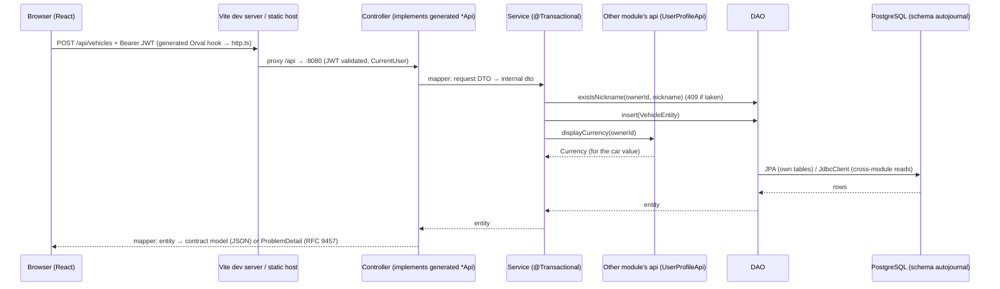

# Architecture

autojournal is a private app for tracking car expenses: a user keeps their vehicles and logs expenses per
vehicle (see [domain](domain/)). It is a monorepo with a Kotlin/Spring Boot
modular-monolith backend, a React SPA frontend, and a contract-first OpenAPI spec between them.

```
contracts/openapi.yaml ──(openapi-generator)──▶ backend: Spring interfaces + models (target/, not committed)
                       └─(Orval)──────────────▶ frontend: TanStack Query hooks + Zod schemas (gitignored)
```

## Architecture standard

> * Architecture: Modular monolith using Spring Boot, Kotlin, and Spring Modulith. One
>   application, one deployment, and one shared PostgreSQL database.
> * Module organization: Organize packages by business domain, not by technical layer.
> * Internal structure: Each module follows the existing layered architecture:
>   `controller → service → dao → repository → entity`, with `dto` and `mapper`
>   packages where needed.
> * Public API: Expose cross-module functionality through explicitly defined interfaces
>   and DTOs in the module's `api` package. Keep implementation details in `internal`.
> * Module boundaries: Modules must not directly access other modules' internal
>   services, repositories, or entities. Business operations must go through the owning
>   module's public API.
> * Database ownership: Each module owns its tables and write operations. Read-only
>   cross-module SQL JOINs are permitted through `JdbcClient` in dedicated read DAOs.
> * Transactions: Service layer owns transaction boundaries and business orchestration.
> * Simplicity: Prefer synchronous module communication. Avoid unnecessary
>   abstractions, events, and microservice patterns unless justified by a concrete
>   requirement.
> * Enforcement: Use Spring Modulith verification tests to validate module dependencies
>   and integration tests for cross-module database queries.

## Database access standard

> Use Spring Data JPA for module-owned persistence and `JdbcClient` for complex or
> cross-module reads. Do not introduce other database access APIs or frameworks
> without architectural approval.

## Module map (backend)

Root package `com.example.autojournal` (`@Modulithic`). Generated contract code lives in
`com.example.contract`, outside the root, so Modulith does not treat it as a module.

| Module     | Responsibility                       | Public API (`api` named interface) | Owns tables | Depends on      |
| ---------- | ------------------------------------ | ---------------------------------- | ----------- | --------------- |
| `users`    | User profile (display currency); `GET/PATCH /api/me` | `UserProfileApi` (`displayCurrency(userId)`) | `user_profile` | `shared` |
| `vehicles` | A user's vehicles (Garage); `/api/vehicles` CRUD | — (none needed yet)    | `vehicle`   | `users::api`, `shared` |
| `shared`   | Error handling, security (JWT resource server, `CurrentUser`), money (`Currency`, `ExchangeRates`), UTC `Clock`, entity base | open module (all packages visible) | — | — |

All tables live in the `autojournal` schema. Database-level foreign keys across modules are allowed
(e.g. the planned `expense.vehicle_id → vehicle.id`); JPA relationships across modules are not.

Reference examples in the code (`vehicles` is the reference module):

- **Cross-module call:** `vehicles/internal/service/VehicleService` — gets the user's display currency
  through `users.api.UserProfileApi` (implemented by `users/internal/service/UserProfileApiService`), never
  through the users repository.
- **Write DAO:** `vehicles/internal/dao/VehicleDao` — wraps the module's JPA repository; `saveAndFlush` makes
  a unique-index violation surface in the service (→ 409 on `nickname`).
- **Cross-module read:** none yet. The first `JdbcClient` read DAO (read-only JOIN of another module's
  table) comes with expenses/insights.

## Request flow



## Frontend structure

```
frontend/src/
  app/        providers, Redux store, router setup (code-based TanStack Router)
  features/   <feature>/ components, hooks, routes, slice — no imports between features
  shared/     api/ (http.ts mutator, generated/), ui/ (shadcn primitives + states), lib/
```

State placement: server data → TanStack Query; shared UI state → Redux Toolkit; form state →
React Hook Form; URL-worthy state → router search params; local state → `useState`.
See [frontend/AGENTS.md](../frontend/AGENTS.md) and ADRs 0006, 0007, 0011.

## Boundaries that matter

- Only the backend connects to the database (ADR 0005). The frontend never uses supabase-js data access.
- The contract is the source of truth for the API; generated code is never edited (ADR 0002).
- Authentication: Supabase Auth JWTs validated by the backend (ADR 0013); `frontend/src/shared/api/http.ts`
  is the single place the token is attached.
